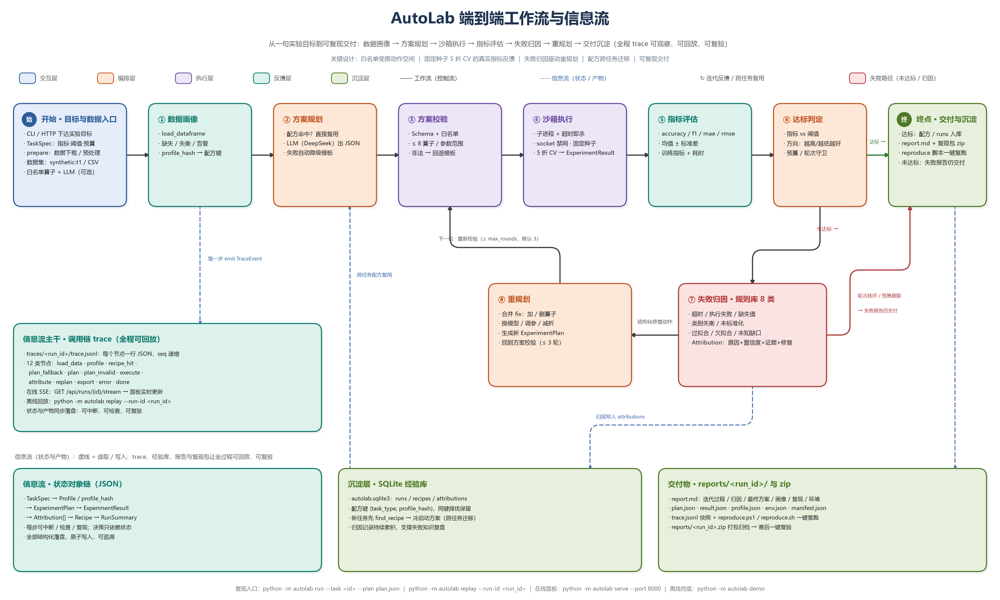

# AutoLab —— 科研实验自动化智能体

> 第六届厦门大学人工智能挑战赛 · 赛道二（AI 智能体创新赛）
> 队伍：**泥虾** ｜ 队长：陈传轩 ｜ 队员：张一鸣、陈景祥、张谋谆

**仓库**：[ThreadDesolated/Xiamen-University-Artificial-Intelligence-Challenge](https://github.com/ThreadDesolated/Xiamen-University-Artificial-Intelligence-Challenge)
克隆：`git clone https://github.com/ThreadDesolated/Xiamen-University-Artificial-Intelligence-Challenge.git`

AutoLab 让 Agent 像研究生一样做实验：给它一句话目标（例如"把这个数据集验证准确率做到 0.85 以上，预算 2 分钟"），
它会自主完成 **数据画像 → 实验方案规划 → 沙箱执行 → 指标评估 → 失败归因 → 重规划 → 配方沉淀与复现包交付**，
全过程写入可回放的调用链 trace。

## 工作流与信息流总览



一张图看懂从「一句话目标」到「可复现交付」的完整闭环：实线是工作流（控制流），虚线是信息流（状态与产物）；
上半部分是主链路与失败重规划循环，下半部分是调用链 trace、状态对象链、SQLite 经验库与交付物。高清原图见
[docs/工作流与信息流.png](docs/工作流与信息流.png)。

## 核心特性

| 特性 | 说明 |
|---|---|
| 指标即奖励的闭环 | 用真实评测指标（K 折交叉验证均值±标准差）作为奖励信号；达标/继续迭代由代码规则与预算决定，而不是模型"自称完成" |
| 失败归因驱动重规划 | 把"实验失败"当一等公民：输出结构化失败原因和修复动作，再生成下一轮方案；线性模型触顶时自动升级到随机森林 |
| 跨任务配方迁移 | 成功方案以"任务画像 + 方案 JSON"沉淀到 SQLite 配方库，新任务先检索复用 |
| 受限动作空间 | 方案是一份 JSON，只允许白名单算子/模型；做 Schema 与白名单双重校验，非法方案回退模板方案 |
| 安全沙箱 | 子进程隔离、超时即杀、socket 级禁网、不依赖 Docker |
| 可复现交付 | 每次运行自动导出 trace、报告、配置、环境信息与一键复现脚本 zip |
| 最终模型导出 | 运行结束把最终方案在训练池上重新拟合，导出 `reports/<run_id>/model.joblib`（预处理 Pipeline + 模型本体 + 元信息），随报告/复现包交付，面板可直接下载 |
| 留出集复验 | 评测时可选先切出独立留出集（`holdout_ratio`，默认 0 不启用；真实任务 t1_adult 用 20%）：K 折划分与选模都不碰它，跑完最后复验一次并写进报告，抑制多轮重规划导致的验证集过拟合 |

## 快速开始（零额外依赖：只用 numpy + pandas）

```bash
pip install -r requirements-core.txt     # 如已装好 numpy/pandas 可跳过
python -m autolab demo
```

`demo` 使用内置合成任务（缺失值 + 类别失衡的高维表格分类），完整走一遍"弱 baseline 失败 → 归因 → 重规划 → 达标 → 导出复现包"：

```
[round 1] plan=template     metric=0.7xxx (<0.85) attribution=[missing_values_poor_imputation, class_imbalance, feature_scale]
[round 2] plan=attribution  metric=0.8xxx (>=0.85) OK
trace:  traces/<run_id>.jsonl
report: reports/<run_id>.zip
```

> 未安装 scikit-learn 也能跑：归因只会升级到 numpy 线性模型（`logistic_gd`），demo 的合成任务照样达标。
> 装有 scikit-learn 时，欠拟合会升级到白名单里的 `random_forest`（更接近真实数据任务的指标上限）。

装齐完整依赖后：

```bash
python -m autolab prepare --task t1_adult        # 下载并准备固定子集（UCI Adult 1k 行）
python -m autolab run --task configs/tasks/t1_adult.json
python -m autolab serve --port 8000              # 启动 Web 面板 + API（见下节）
python -m autolab replay --run-id <run_id>       # 回放一次运行（演示断网兜底用）
python -m autolab predict --model reports/<run_id>/model.joblib --csv data.csv   # 用导出的最终模型预测
python -m autolab model-info --run-id <run_id>                   # 按 run_id 查看模型全貌（超参/特征/重要性）
python -m autolab run --plan latest              # 用最近一次实验保存的方案原样复现（不用手找 plan.json）
python -m unittest discover -s tests -v          # 跑测试
```

`复现验收.cmd` 优先按交付包里的 `reports/acceptance_1/plan.json` 原样复现；仓库工作树里没有这份验收证据时，
会自动回退成 `--plan latest`（取最近一次实验的方案），不再报 Traceback。

`t1_adult` 是真实数据任务（1000 行 Adult 子集，正负比 750/250）：线性模型上限约 0.845，达不到 0.85 阈值，
归因会在第 2 轮把模型升级为随机森林，实测 0.5230 → 0.8560，两轮达标（需 `pip install -r requirements.txt`，
其中包含 scikit-learn；跳过的旧报告 `reports/run_20261118_204250_82d7aa` 可作修复前对比）。

该任务的配置启用了留出集复验（`holdout_ratio: 0.2`）：1000 行中先切 200 行留出集，K 折只在其余 800 行上做，
达标判定仍看 CV 均值；跑完再在留出集上评估一次（实测 CV 0.8538、留出集 0.8350），
报告与 CLI 都会打印这个"对外泛化"成绩，避免多轮重规划把验证集调过头。`t1_demo` 保持 `holdout_ratio: 0`。

## 用导出的最终模型预测（CLI）

跑完任务后 `reports/<run_id>/model.joblib` 就是最终模型，可以直接对**新数据**预测，不需要重新训练：

```bash
python -m autolab predict --model reports/<run_id>/model.joblib --csv new_data.csv --out preds.csv --proba
```

- 默认按模型元信息里的 `target` 列名从 CSV 中剔除标签列；数据是纯特征（没有标签）也能直接预测；
- `--proba`：分类任务额外输出正类概率列；`--target` 可手动指定目标列名；
- `--out`：结果写 CSV（`row,prediction[,probability]`）；不加 `--out` 只打印前 10 行和预测分布（分类）或统计（回归）。

## 查看导出的模型（CLI）

`model.joblib` 是二进制文件，用 `model-info` 一次看全：元信息、实验方案、预处理参数、特征名单、训练结果（树的数量/节点数/重要性或权重摘要）。**给 run_id 就行**，会自动定位 `reports/<run_id>/model.joblib`：

```bash
# 最常用：按 run_id 查（run_id 在面板历史或 reports 目录名里都能看到）
python -m autolab model-info --run-id run_20261122_230052_2c15a7

# 也可以直接给文件路径（比如面板下载到本地的模型）
python -m autolab model-info --model joblibs/run_20261122_230052_2c15a7-model.joblib

# 看全部特征名 / 只取前 5 项 / 输出 JSON 给脚本处理
python -m autolab model-info --run-id <run_id> --features
python -m autolab model-info --run-id <run_id> --top 5
python -m autolab model-info --run-id <run_id> --json > model_info.json
```

输出示例（UCI Adult 随机森林）：

```
文件大小: 550.8 KB  格式: autolab.model.v1  序列化: joblib
任务: t1_adult（binary_classification）  目标列: income  指标: accuracy
模型: random_forest  超参数: {"n_estimators": 300, "max_depth": 8, "min_samples_leaf": 1}
CV 均值: 0.85375  类别: [0, 1]  sklearn: 1.9.1
...
训练结果
  内部实现: sklearn RandomForestClassifier  实际树数: 300  总节点数: 29620  平均节点/树: 98.7  最大树深: 8
  特征数: 82  类别数: 2
  特征重要性 Top 8:
       education_num: 0.1162
       capital_gain: 0.1153
       marital_status=Married-civ-spouse: 0.0939
       ...
```

- 超参数与"模型是什么方案训练出来的"在 `meta` / `meta.plan` 里；预处理参数（onehot 类别表、标准化均值/方差、填充值）在 `pipeline.state` 里；
- 训练后参数：随机森林的 `feature_importances_`、`estimators_`（每棵树），numpy 线性模型的 `W_` / `w_` 都会汇总展示；
- `--json` 输出结构化摘要（`meta` / `plan` / `pipeline` / `model.trained`），便于二次处理。

Windows 下也可以直接双击 `查看模型.cmd`：不带参数会先列最近 5 条运行再提示输入 run_id；也可以带参数运行，例如 `查看模型.cmd <run_id> --features`。

## Web 面板（调用链可视化）

```bash
pip install -r requirements-panel.txt   # 首次需要：fastapi + uvicorn
python -m autolab serve --port 8000
```

浏览器打开 http://127.0.0.1:8000/ ：

- 左侧选择任务，勾选「复用成功配方」后点「开始实验」，右侧实时显示指标、轮次与调用链轨迹（前端 1 秒轮询；SSE 接口 `/api/runs/{run_id}/stream` 已就绪，可后续接入）；
- 指标区含「留出集复验」卡片：任务启用 `holdout_ratio` 时显示最终方案在留出集上的指标（不参与达标判定；未启用显示 —），轨迹与报告第五节同步给出；
- 跑完出现报告 Markdown 链接与「下载模型 ↓」链接（`GET /api/runs/{run_id}/model`，拿到 `model.joblib`）；左侧「实验历史」可点开任意历史 run 回看完整 trace；
- 每条历史记录右侧有「删除」按钮：确认后删除该次运行的记录、轨迹、报告与复现包
  （配方库保留；运行中的实验需等结束后再删，避免 trace 写一半）；
- 支持批量删除：勾选多条（或点「全选」）后点「删除所选（N）」，逐条尽量删，
  运行中/不存在的记录会在提示里列出；批量接口 `DELETE /api/runs`（body `{"run_ids": [...]}`，
  一次最多 100 条）；
- 接口文档在 `/docs`（Swagger），健康检查 `/api/health`。

前端源码在 `autolab/serving/web/`（`index.html` / `app.js` / `style.css`），纯静态、无需 Node 构建；后端由 `autolab/serving/server.py` 挂载 `/panel` 静态目录并在 `/` 返回面板首页。

## 环境安装

- Python 3.10+（开发机 3.12）
- 最小运行：`pip install -r requirements-core.txt`（numpy、pandas）；demo/合成任务零额外依赖
- 完整开发：`pip install -r requirements.txt`（W2 起需要 scikit-learn / flaml / fastapi / langgraph）
- 真实数据任务（如 `t1_adult`）建议装完整依赖：归因升级用的 `random_forest` 模型依赖 scikit-learn；
  未安装时自动退回 numpy 线性模型，demo 与合成任务不受影响。
- 大模型（可选）：`cp .env.example .env` 后填 `DEEPSEEK_API_KEY`。
  未配置 Key 时自动退化为 **模板规划器 + 规则归因**——这是现场断网/限流时的兜底路径，永远可用。
- 最终模型导出：优先用 `joblib`（scikit-learn 自带）；未安装 joblib 时自动退回标准库
  `pickle`，零依赖的 numpy demo 也能导出 `model.joblib`。

## 目录结构

```
.
├── autolab/
│   ├── schemas.py            # 任务 / 画像 / 方案 / 结果 / trace 数据结构（与 docs/接口契约.md 一一对应）
│   ├── profile.py            # 数据画像
│   ├── config.py             # 路径与运行配置
│   ├── cli.py                # 命令行入口（demo / run / prepare / predict / model-info / serve / replay）
│   ├── agent/                # 编排层
│   │   ├── graph.py          #   闭环主链路：profile → plan → execute → evaluate → decide → attribute → replan
│   │   ├── planner.py        #   模板规划器（离线保底） + LLM 规划器（JSON 约束）
│   │   ├── attributor.py     #   失败归因规则 + 重规划
│   │   └── prompts.py        #   提示词
│   ├── sandbox/              # 执行层
│   │   ├── validate.py       #   Schema + 白名单校验
│   │   ├── operators.py      #   白名单算子/模型实现
│   │   ├── executor.py       #   子进程执行器（超时/禁网/隔离）
│   │   ├── runner.py         #   沙箱子进程入口（跑交叉验证、写 result.json）
│   │   └── netguard.py       #   socket 级禁网
│   ├── evaluation/           # 评测层
│   │   ├── metrics.py        #   accuracy / f1_macro / rmse / mae
│   │   ├── model_store.py    #   最终模型导出/加载（joblib，缺 joblib 退 pickle）
│   │   └── protocol.py       #   固定种子 K 折交叉验证协议（可选留出集）
│   ├── tracing/              # 可观测层
│   │   ├── logger.py         #   JSONL trace 写入 + 订阅（SSE 用）
│   │   └── replay.py         #   trace 回放
│   ├── store/db.py           # 配方库 + 归因知识库 + 运行记录（SQLite）
│   ├── report.py             # 实验报告 + 复现包导出
│   ├── datasets/             # 数据集准备与加载（合成/真实）
│   └── serving/              # FastAPI + SSE 服务与 Web 面板
│       ├── server.py         #   服务入口（含 /panel 静态挂载与 / 首页）
│       └── web/              #   纯静态前端（index.html / app.js / style.css）
├── configs/
│   ├── whitelist_ops.json    # 动作空间白名单（算子、模型、参数类型/范围）
│   └── tasks/*.json          # 任务配置（数据路径、目标指标、预算、轮数）
├── docs/                     # 设计方案、接口契约、演示剧本、工作流与信息流总览图
├── tests/                    # unittest（无需 pytest）
├── traces/                   # 运行时 trace（git 忽略）
├── reports/                  # 运行报告与复现包（git 忽略）
└── data/                     # 数据集缓存（git 忽略内容）
```

## 任务配置

`configs/tasks/*.json` 的字段见 [docs/接口契约.md](docs/接口契约.md#1-taskspec任务配置)：

```json
{
  "task_id": "t1_adult",
  "name": "UCI Adult 收入二分类（固定子集）",
  "task_type": "binary_classification",
  "data_path": "data/processed/t1_adult.csv",
  "target": "income",
  "metric": "accuracy",
  "threshold": 0.85,
  "higher_is_better": true,
  "n_splits": 5,
  "seed": 42,
  "budget_seconds": 120,
  "max_rounds": 3,
  "holdout_ratio": 0.2
}
```

## 白名单动作空间

方案 JSON 只能引用 `configs/whitelist_ops.json` 中声明的算子、模型与参数范围，例如：

```json
{
  "ops": [
    {"op": "impute_median", "params": {}},
    {"op": "scale_standard", "params": {}},
    {"op": "onehot", "params": {"max_categories": 20}}
  ],
  "model": {"kind": "logistic_gd", "params": {"lr": 0.1, "epochs": 300, "class_weight": "balanced"}},
  "eval": {"n_splits": 5, "seed": 42}
}
```

非法方案（未知算子 / 参数越界 / 超长）会被 `sandbox/validate.py` 拦下，并自动回退到模板方案——保证现场演示不会因为模型幻觉直接崩掉。

## 开发计划（W1–W5，2026-11-02 → 12-05）

| 周 | 目标 | 验收 |
|---|---|---|
| W1 | 骨架跑通：`demo` 全链路可跑、trace 可回放、接口契约冻结 | `python -m autolab demo` 通过 + 测试全绿 |
| W2 | 表格域真数据：T1 自动达标（≤2 轮、<30s）、归因库/配方库落库 | `run --task t1_adult` 达标 |
| W3 | 图像域 + 时序域 + 配方迁移证据（T3 首轮命中） | 三任务全跑通 |
| W4 | 指标实测校准、断网回放演练、3 次彩排、视频/报告 | 断网也能完整演示 |
| W5 | 彩排与材料定稿，12-05 初赛 | 现场 3 分钟脚本零失误 |

## 团队分工

| 成员 | 角色 | 主责 |
|---|---|---|
| 陈传轩（队长） | 项目负责人 / Agent 与算法 | 架构与接口、编排与提示词、规划/归因策略、评测协议、语音入口、答辩主讲 |
| 张一鸣 | 工程 / 后端与执行 | FastAPI+SSE、沙箱执行器、SQLite 配方/归因库、trace 采集回放、部署测试 |
| 陈景祥 | 算法与实验 | 数据集与指标脚本、算子库、baseline 与演示案例、归因规则与回归 |
| 张谋谆 | 可视化与交付 | trace 面板前端、复现包/README、演示视频与 PPT、现场第二操作手 |

## 演示与兜底

- 现场演示 3 分钟剧本见 [docs/演示剧本.md](docs/演示剧本.md)
- **回放兜底**：所有演示任务提前跑通并把 trace 缓存下来；现场断网/API 限流时 `python -m autolab replay <trace.jsonl>` 一键切回放
- **2+1 任务边界**：表格 + 时序 2 个任务保底，图像域作加分项
- 演示全程录屏，赛前一周冻结功能

## 说明

- 作品为本届赛事新设计开发，未使用往届作品原样参赛，也不属于科研项目包装。
- 使用的开源库与公开数据集均遵循其许可证，来源、版本与引用见技术报告与 `requirements.txt`。
- 设计方案全文见 [docs/设计方案_泥虾队.docx](docs/设计方案_泥虾队.docx)。
